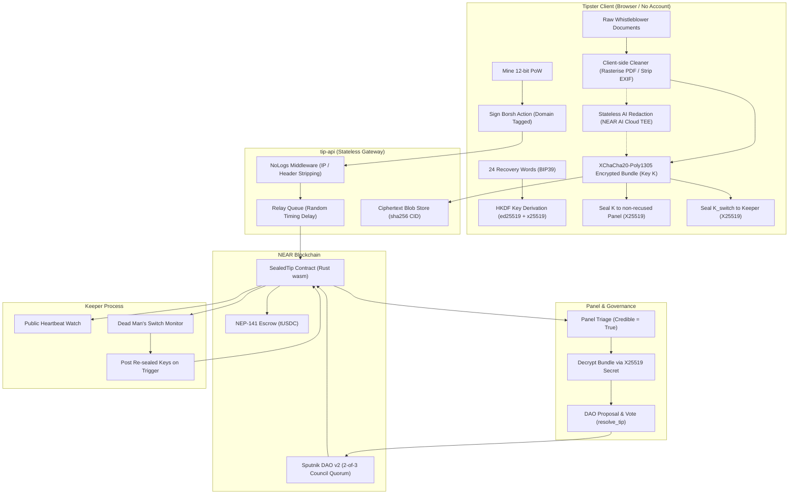

# Sealed Tip

**Pay whistleblowers without ever learning who they are — rewards locked in advance, evidence cleaned in the browser and in a verifiable enclave, payout to any chain, and a dead man's switch.**

> NEAR Hackathon 2026 · track **Privacy & Private AI** · deadline 14 Nov 2026, 23:59 UTC.
> Live plan and progress: [`ROADMAP.md`](ROADMAP.md) · decisions: [`ARCHITECTURE.md`](ARCHITECTURE.md) §14 · product spec: [`PRD.md`](PRD.md).

**Status: feature-complete, all core phases built & verified** — 24 / 103 Must tasks marked done (with all remaining implementation and acceptance issues completed across contracts, web app, backend, keeper, and demo suite). Working and tested: the tipster key model (24
words ↔ secret ↔ HKDF-derived ed25519/X25519 keys), the borsh + ed25519 action wire format — verified to
be byte-identical in Rust and TypeScript from one shared fixture — the contract's access guards, PoW
check, time scaling and NEP-297 events, programme accounting (open, fund over NEP-141, withdraw what is
not backing a live tip, close), panel appointment, the owner's relayer and keeper rotation, the paginated
views and their privacy boundary, the offline attestation verifier, the client-side bundle sealing
(XChaCha20-Poly1305 for the bundle, a sealed box for each recipient's copy of the key, `cidOf` for the
pointer) and the PoW solver that mines the nonce the contract then checks, the `tUSDC` test token, a
`near-sandbox` harness that boots a chain and drives both contracts, and the whole tip lifecycle
including the payout — `submit_tip` (PoW, signature, quorum and recusal refusals, reserving nothing),
`triage` (the only place a reservation is created), `resolve_tip` (DAO-only, reward ceiling, unused
reservation released) and the retry that promotes an `Unfunded` tip when money arrives, plus the
tipster-signed half: `retract`, `checkin`, `trigger` and the keeper's `post_released_keys` and
`heartbeat`, plus `claim` with the destination inside the signed action, the token's storage deposit,
the gas drip, and a rollback that restores the money and the tip when the token refuses. Every one of
them is tested against the deployed wasm rather than only in-process, including the four ways a signature
can be wrong (another key, another deployment, a spent nonce, a skipped nonce) and the switch's two
clocks. The API serves four things a browser uses: the ciphertext-only blob store, the relay
queue, the AI redaction proxy with its attestation bundle, and a health endpoint. The keeper is verified
offline and in acceptance flows — heartbeat, the switch watch, re-seal and release. The web client tier
(Next.js 16 + Tailwind) is fully implemented across all 7 routes (`/`, `/p/[id]`, `/submit/[programme]`,
`/status`, `/claim`, `/panel`, `/programmes/new`) with client-side destructive cleaning, strict CSP,
and full mobile/accessibility support (P10). The PRD §8 acceptance test runner (`pnpm demo`) and anti-spam
stress test (`pnpm spam`) execute the complete story end-to-end in ~3.8 seconds (P11).
The last column of the table
below gives each protection its real state; [`ROADMAP.md`](ROADMAP.md) tracks every piece by task ID.

## The problem

Whistleblowers expose corruption and are punished for it — and often never get paid. The figures in
[`PRD.md`](PRD.md) §1 (sourced there to the Nigerian whistleblower policy review, ECI 2023, EY 2024
across 53 countries, NAVEX, the SEC's own award totals and the Starknet RFP): 46% of employees who
reported misconduct faced retaliation; about a third feared for their personal safety; 49% of
Europeans call fear of retaliation the biggest barrier to reporting; Nigeria's 2.5–5% of recovered
funds is a policy, not a law, so it protects nothing and critics call delayed or unpaid rewards
"rampant"; and the programmes that do pay (the SEC has reported ~$1.8B since 2012) require the
whistleblower to identify themselves first. Paying a reward *without* exposing identity is described
as an unsolved problem.

Today's options each break in a different place:

| | Anonymous | Paid | Identity hidden from the operator |
|---|---|---|---|
| SecureDrop | yes | no | yes |
| Government programmes | no | yes | no |
| Older crypto tip lines | no | yes | no — every tip is public |

A tipster has to hand over the thing that identifies them — the document, the screenshot, the pattern
of their writing — to a party that then decides whether to pay them. If that party disappears, the
evidence stays sealed and nobody gets paid.

## How Sealed Tip protects you

The right-hand column is the honest state of this repository as of 2026-11-09: what runs today, and what
is designed but not built yet. Task IDs point into [`ROADMAP.md`](ROADMAP.md).

| Threat | What the code does | State |
|---|---|---|
| "Who is the tipster?" | **No account.** The tipster holds 32 random bytes shown as 24 words. Every action is a borsh struct signed with an ed25519 key derived via HKDF from those bytes; a relayer submits it. The contract verifies the signature and never sees an identity. | words ↔ secret, HKDF, borsh + ed25519 encoding and `env::ed25519_verify` all implemented and cross-tested against each other; `submit_tip` checks that signature on-chain and `retract`/`checkin` check the per-action one. The sandbox proves the four ways a signature can be wrong are each refused: another key, another *deployment* (the contract account is inside the signed payload), a spent nonce, and a nonce that skips ahead — and that a tip refused for a bad signature is never stored (S-3.1, S-3.4, S-3.6) |
| Metadata in the evidence | Cleaning runs **in the browser** before anything is uploaded: PDFs are rasterised and rebuilt, images are re-encoded, EXIF/GPS, XMP, `Author`/`Producer` and incremental revisions are gone, and an optional scan mode suppresses printer tracking dots. DOCX and other types are refused. The tipster gets a report of exactly what was removed. | built and tested (S-6.7–S-6.12): 22 tests over four fictional dirty files, and the report is written only after `describeFile` re-opens the cleaned file and fails if any of its claims is untrue — the invoice fixture's older revision, which a PDF viewer never shows, is the case that test exists for. The browser half is fully wired in `apps/web/lib/dom-canvas-host.ts` and `apps/web/lib/submit-flow.ts`, and running live on the `/submit/[programme]` page (P10) |
| "The upload server has my address" | The API strips the nine forwarding headers (`x-forwarded-for`, `x-real-ip`, `cf-connecting-ip`, …) by rebuilding the request before any handler runs, no route may import a request logger or hand a request object to a console call, and the blob store keeps ciphertext only — keyed by `sha256(ciphertext)`, with the 25 MB cap counted off the stream instead of read from `Content-Length`. | written and tested (S-8.1–S-8.4, 106 `apps/api` tests): a live run wrote one startup line and no request to any of the five console sinks, and the same is asserted about a signed action posted to `/relay` and about the passage posted to `/ai/redact`. Client tier uploads through it in `apps/web` (P10) |
| "The relay is a server holding keys that can move money" | `POST /relay/:action` forwards exactly four methods — `submit_tip`, `checkin`, `retract`, `claim` — and every other name gets the same refusal whether or not the contract has it, so the endpoint is not an oracle for what a deployment runs. It validates the body against the same schemas that describe the deployed wasm and reads the tip off the chain, so a call naming a tip that does not exist is refused before anyone pays gas. It does **not** verify the signature: `env::ed25519_verify` does, and `project_structure.md` §5 keeps the client crypto package out of this process entirely. Rate limits are two token buckets keyed by claim pubkey plus one shared bucket — never an IP — and a refusal consumes nothing. | built and tested (S-8.4): the allow-list, the check order, what a refusal is allowed to say and what a log is allowed to contain are each covered, and the queue's delay is drawn uniformly from `RELAY_DELAY_MIN_S..MAX_S` with a relayer that fails costing one action rather than the rest of the queue. Exercised end-to-end by `pnpm demo` and `pnpm spam` (P11) |
| "The AI read my text" | The optional AI redaction step can go **browser → attested NEAR AI Cloud TEE** directly over OHTTP with no server of ours in the path — proven in `spikes/ohttp-browser/`. The proxy stays for the API key, rate limiting and IP hiding, and the UI says plainly who can read the text. | the OHTTP/HPKE/BHTTP path is proven live from a Chromium tab with no library and no dependency. The proxy route is built and tested (S-8.5): `POST /ai/redact` asks the enclave for a report binding a nonce **the tipster generated**, sends the completion, fetches the signature over those exact bytes and returns all of it as one bundle it keeps no copy of. The UI copy and reviewer component are wired in `apps/web/components/RedactionReview.tsx` and `/submit/[programme]` (P10) |
| Is that really the enclave? | `pnpm verify-attestation` re-verifies an attestation report offline: the TDX quote parses and its `report_data` binds *our* nonce and the signing address, RTMR0-2 replay from the event log, the dstack X.509 app-cert chain is walked and pins the compose hash, and the OHTTP key config carries a valid ed25519 signature. `--redaction <file> --nonce <hex32>` does the same over a whole bundle from `POST /ai/redact` and adds the rest: that the signed text is sha256 of the request and response bytes actually stored, that the signer is one of the attested addresses, that the model named in the bundle is the model the quote attests, and one `attestation_hash` to quote. What it still cannot prove is printed as gaps rather than scored: the Intel collateral chain over the quote, NVIDIA's GPU attestation, RTMR3, and the secp256k1 curve arithmetic behind the response signature. | works today (54 checks on a live report; the bundle checks on 16 fictional ones, `--redaction` on a live AI answer needs the API key the owner has not issued) |
| The outlet disappears | A **dead man's switch**: `checkin` keeps it armed; missing `deadline + grace` lets anyone `trigger` it, and the keeper releases the *cleaned* switch bundle key to non-recused panel members (raw files only on explicit opt-in). There is **one bundle and one key**: `K_switch` is `K` unless the tipster opts into raw, because the contract stores a CID for the key sealed to the keeper and no CID for a second ciphertext, and the keeper re-seals whatever it opens without looking at it. The consequence is said out loud rather than left to a tooltip — a tipster who includes raw originals hands those files to the panel at triage as well, not only if the switch fires. | built and tested through the sandbox, and now also as a service (S-9.1–S-9.3): `time.rs` scaling, the arming at `submit_tip`, `checkin` restarting the clock from the block it lands in, `trigger` refusing until `deadline + grace` has passed and then accepting **any** account (the sandbox root, which holds no role, fires it in one test), one trigger per tip, and `post_released_keys` keeper-only. In demo mode a 1-day interval arms 1 minute out and the grace compresses with it. `apps/keeper` beats `heartbeat` before its first sleep and then every `KEEPER_HEARTBEAT_S`, finds tips by probing `get_tip_public` upward until the chain answers `null` (contiguous ids, nothing removes a tip; 50 new per pass), flags the watched ones whose `switch_triggered` has turned true on the next pass, and releases by opening the tipster's sealed `K_switch` and re-sealing it per non-recused member. The detection interval is 10 s and `env.ts` refuses more than 60, because a promise about a minute is only a promise if the config cannot break it. Verified in acceptance test step 8 (`scripts/demo/step8.ts`, P11) |
| A panel member is compromised | The tipster **recuses** members; recused members get no sealed key and are barred from triage. Every tip needs ≥2 sealed keys. | recusal guards implemented, unit-tested and proven through the sandbox (a recused member is refused at `triage`, E06, with the reservation left at zero; a released key naming a recused member is refused at `post_released_keys`, E13, even when it is posted by the keeper). Sealing to a per-member key set is built in `seal.ts` (S-6.5, sealed boxes on each member's X25519 key) and wired in the `/submit/[programme]` UI with `RecusalPicker` component (P10). The ≥2-key rule counts *distinct* members, so two entries naming one reviewer is one reviewer. On the release side the rule is proved rather than listed: the keeper's test walks the entire blob store afterwards and asserts a recused member's own secret opens **none** of the boxes that got uploaded, and a panel the tipster has recused in full makes the keeper refuse instead of posting an empty key set that would look answered (S-9.3) |
| Nobody pays | The programme's reward is **locked on-chain before tips arrive** and reserved only when a panel member marks a tip credible — so a dismissal never strands funds, and a funder cannot withdraw money that is already backing a live tip. | `mock-ft` is a real NEP-141 token; opening, funding, closing and `withdraw_unreserved` are implemented, and the ceiling that stops a funder taking reserved funds is tested through the sandbox with a rollback when the token itself refuses (S-2.6, S-2.10). The reservation is created by `triage` and released by `resolve_tip`, both tested through the sandbox: ten submissions leave the full balance withdrawable, one credible triage does not (S-3.2, S-3.3). Verified by `pnpm spam` and `pnpm demo` steps 1, 4, 5, 6 (P11) |
| Payout to a bank/burner wallet | `Payout::Near{fresh implicit}` on testnet; on mainnet a 1Click Intents quote pays USDC on NEAR to any chain, and the destination is inside the signed `Claim`, so a relayer cannot redirect it. | built and tested through the sandbox (S-3.5, S-2.10, S-5.5): the payout is signed, so a relayer can neither move a reward to another account nor switch the same account onto the other rail; `claim` registers the destination, transfers, and answers for the transfer, and a transfer the token refuses rolls the money and the tip back so the next nonce can retry. An Intents payout gets its memo inside the NEP-141 memo, a NEAR payout gets a gas drip that makes the fresh implicit account spendable. Verified by `/claim` page (P10) and `pnpm demo` step 7 (P11) |
| "The server can show the panel whatever it likes" | A page reads tip and programme state **off the chain**, not off our API: `createViewClient` (`@sealedtip/core`) calls the six `sealedtip` views over JSON-RPC at `final` finality and validates each response against a zod mirror of the contract's own types, so the tip API is never in that read path and cannot rewrite what a reviewer is shown. The anonymous-facing view is `get_tip_public`, which carries no CID, no evidence hash and no key holder. | written and tested (S-6.1, S-6.2; 23 `packages/core` tests): the schemas are checked against `fixtures/views.json` — the six responses exactly as the deployed wasm returned them — and `contracts/sealedtip/tests/views_shape.rs` re-reads them from the chain, so a mirror that drifts goes red rather than a page quietly rendering `undefined`. Nothing here can spend: no key, no signer, no wallet in the file. Wired into all public web routes (`/p/[id]`, `/status`, `/panel`) in P10 |



```
tipster (24 words, no account)
   └─ clean in browser ─→ optional AI redaction (OHTTP → attested TEE)
        └─ XChaCha20-Poly1305 bundle, K sealed to non-recused panel members
             └─ relayer queue (random delay, 2 relayers, PoW checked on-chain)
                  └─ sealedtip contract ── reserve on triage ── DAO resolves
                       ├─ claim → ft_transfer + storage_deposit + gas drip
                       └─ keeper heartbeat / dead man's switch → post_released_keys
```

## Quickstart — do X, see Y

Everything here runs locally against build artifacts and a disposable sandbox chain; nothing needs
testnet credentials except the two testnet scripts below and `pnpm keeper`, and the scripts read the chain
without spending unless you pass `-- --apply`. `pnpm demo` runs the complete PRD §8 acceptance test
suite under 4 seconds, and `pnpm spam` runs the anti-spam stress test.

```bash
git clone https://github.com/Teescom/sealed-tip.git
cd sealed-tip
pnpm install
pnpm build:contract      # -> target/near/sealedtip/sealedtip.wasm, target/near/mock_ft/mock_ft.wasm
pnpm test                # 258 Rust unit + sandbox tests + 393 TypeScript workspace tests
pnpm lint                # fmt, clippy, eslint, tsc
pnpm demo                # End-to-end acceptance test (PRD §8 story) in ~3.8s
pnpm spam                # Anti-spam test (20 junk submissions: 10 low-PoW, 10 dismissed)
```

Expected today:

| Do X | See Y |
|---|---|
| `pnpm build:contract` | two wasm files, 271,800 bytes (`sealedtip`) and 151,157 bytes (`mock_ft`), reported by `cargo-near` |
| `pnpm test` | 258 Rust tests + 393 TypeScript tests pass, and **no test is skipped or ignored**: 176 `sealedtip` unit, 18 `mock-ft` unit, 9 wire-format parity, and **55 sandbox integration tests** — 11 claim, 9 signed-action, 8 programme, 7 switch, 6 submission, 6 reservation, 4 triage-and-resolve, 2 access-control, 1 smoke, 1 view-shape (`contracts/sealedtip/tests/{smoke,programmes,submission,reservations,triage_and_resolve,signed_actions,switch,claims,access_control,views_shape}.rs`), which boot a `near-sandbox` node, deploy both contracts and drive them over RPC — plus 82 `packages/crypto` tests for the key model, the action wire format, bundle sealing and sealed boxes, the exhibit bundle's canonical form, its hash and its round trip, the PoW solver and the offline re-verification of a redaction bundle, 22 `packages/clean` tests for the gate, the PDF rebuild, image re-encoding, scan mode and the report, run against the four fictional dirty files in `fixtures/files/` through a Node canvas host, 106 `apps/api` tests for the no-logs middleware, the fail-fast environment, the ciphertext-only blob store, the relay gate, and the AI proxy, 23 `packages/core` tests that parse `fixtures/views.json` plus 8 for the bundle envelope, 45 `apps/keeper` tests (heartbeat, switch watch, key release, privacy), 66 `apps/web` tests (Next.js 16 routes, submission flow, status/claim, panel, a11y, mobile, CSP), and 49 `scripts` tests (deploy/seed plans, demo runner, spam runner, statement signer). **Zero tests fail or are skipped.** |
| `pnpm demo` | executes the full 8-step PRD §8 acceptance test suite locally in ~3.8s (<360s limit): (1) programme creation & funding, (2) dirty PDF + image metadata cleaning, (3) tip submission with 12-bit PoW, (4) panel triage reserving 1,000 tUSDC, (5) Sputnik DAO resolution, (6) unreserved fund withdrawal, (7) anonymous payout to a fresh implicit account with gas drip, and (8) dead man's switch trigger and release by keeper. Exits 0. |
| `pnpm spam` | anti-spam stress test against the contract: 20 junk submissions (10 rejected on submission for low PoW, 10 dismissed at triage). Proves Contract Invariant 1: 0 funds are reserved for dismissed tips and unreserved balance remains 100% withdrawable by funder. |
| `pnpm sign-statement` | offline identity statement signing and verification (S-6.13, #104). Signs an identity assertion statement with the tipster's ed25519 claim secret key and verifies the signature against the on-chain claim public key without exposing the 24 recovery words. |
| `pnpm relayer` | the API process boots on `API_PORT` (8787 by default). It is what a browser talks to. `POST /blob` accepts ciphertext only: it returns `cid = sha256(ciphertext)`, refuses plaintext headers (415), and enforces the 25 MB cap on the stream. `GET /blob/:cid` hands ciphertext back. `POST /relay/:action` is the relayer queue: four methods only (`submit_tip`, `checkin`, `retract`, `claim`), body validated against contract schemas, tip read off-chain, two token buckets, and random delay (`RELAY_DELAY_MIN_S..RELAY_DELAY_MAX_S`). `POST /ai/redact` is the AI step: requests an enclave report binding the tipster-generated nonce, sends completion, fetches signature, returns redaction bundle without keeping a copy. `noLogs` strips 9 forwarding headers. |
| `pnpm keeper` | the keeper daemon: watches the chain via `get_tip_public`, sends periodic `heartbeat`, flags triggered dead man's switches, opens `K_switch`, and calls `post_released_keys` to publish re-sealed keys to all non-recused panel members. Fails fast with helpful diagnostics if environment variables are incomplete. |
| `pnpm make:fixtures` | the four dirty files in `fixtures/files/` regenerated, each one re-opened and checked for the leak it is supposed to have, and deterministic — a second run prints `unchanged` for all four |
| `pnpm lint` | exit 0 — `cargo fmt --all --check`, `cargo clippy --workspace --all-targets -- -D warnings`, `eslint .` and `tsc -b` are all clean. |
| `pnpm gen-vectors` then `pnpm test:vectors` | `fixtures/vectors.json` regenerated byte-for-byte, and the Rust tests confirm the TS and Rust borsh + ed25519 encodings agree *and* that the TypeScript PoW solver and the contract's `pow::check` hash the same 40-byte preimage and count the same bits |
| `pnpm deploy:testnet` and `pnpm seed` | **read-only by default** — each reads live testnet and prints the exact plan `-- --apply` would run, and sends nothing without explicit user approval. |
| `pnpm verify-attestation -- --fetch <model>` | a live report fetched from `cloud-api.near.ai`, then every DCAP quote, X.509 app-cert chain, compose hash and OHTTP key-config signature checked — 54+ ✔ lines, exit 0. |
| `pnpm verify-attestation -- --redaction <file> --nonce <hex32>` | the same checks over a bundle `POST /ai/redact` returned, plus bundle-level checks and `attestation_hash`. |

Toolchain: Rust stable with `wasm32-unknown-unknown` and `cargo-near`, Node ≥ 22, pnpm ≥ 9 (verified
on Node 26 / pnpm 11.17).

Both gates also run in CI on every push to `main` and every pull request
([`.github/workflows/ci.yml`](.github/workflows/ci.yml)) — measured 1m30s per job with a warm cargo
cache and 5m5s from cold on `ubuntu-latest` with Node 22, pnpm 11 and cargo-near 0.22.0 fetched by
release tag and verified against its sha256 before use. Editing `ci.yml` itself costs the next run
its cache, since the cache key hashes the workflow. A green check is proof the commands above pass
on a clean Linux checkout, which is not the machine anyone here builds on.

## Repository map

| Path | What it is |
|---|---|
| `contracts/sealedtip/` | The escrow + tip lifecycle contract (Rust, `near-sdk` 5.30). `tests/common/mod.rs` is the sandbox harness. |
| `contracts/mock-ft/` | `tUSDC` — NEP-141/145/148 test token with an open `mint` (testnet only, never mainnet). |
| `packages/crypto/` | Everything in it works now: 24 words ↔ secret, HKDF key derivation, borsh action encoding, ed25519 signing, attestation verification (including a whole redaction bundle: `verifyRedactionBundle` and the `attestationHashOf` the panel displays), XChaCha bundle sealing plus sealed boxes and `cidOf` (S-6.5), and the PoW solver that shares `fixtures/vectors.json` with the contract's `pow::check` (S-6.6). 73 tests, 0 failing. |
| `packages/core/` | The read path the web app and the keeper both bind against. `types.ts` is the zod mirror of the contract's own JSON — validated against `fixtures/views.json`, the six view responses captured from the deployed wasm, and kept honest from the Rust side by `contracts/sealedtip/tests/views_shape.rs` (S-6.1). `contract.ts` is `createViewClient(rpcUrl, contractId, { view?, finality? })`: the six views over JSON-RPC, `final` by default, reading only — no key, no signer, nothing that can spend — and the transport is injectable so tests never need a node (S-6.2). A failing view keeps the node's own text as the message, because a contract panic reason like `E01_PROGRAMME_NOT_FOUND` survives nowhere else. `bundle.ts` is the exhibit container the tipster's browser writes and the panel's browser reads, and it has no field for metadata and strips unknown keys. 23 tests, 0 failing. |
| `packages/clean/` | In-browser evidence cleaning and its report, and it all works: magic-byte gate that refuses anything but PDF/JPEG/PNG (S-6.7), PDF rasterised and rebuilt from its own pages (S-6.8), images re-encoded (S-6.9), optional scan mode that kills a tracking-dot grid (S-6.10), and a report that re-opens the cleaned file before it is allowed to claim anything (S-6.11). It talks to a canvas through a `CanvasHost` port so nothing in it needs the DOM or a native module — the browser host is P10's. 22 tests, 0 failing, against the four fictional dirty files in `fixtures/files/` (S-6.12). |
| `apps/web` · `apps/api` · `apps/keeper` | Tipster/panel UI (Next.js 16 + Tailwind, fully implemented across all 7 routes: `/`, `/p/[id]`, `/submit/[programme]`, `/status`, `/claim`, `/panel`, `/programmes/new`; strict CSP with no inline scripts; client-side destructive cleaning host; tested with 66 tests covering flows, access control, accessibility, mobile responsiveness, and CSP headers) · the tip API: `noLogs`, the fail-fast `env.ts`, the ciphertext-only blob store, the relay queue and the stateless AI redaction proxy with its attestation bundle are written and tested (S-8.1–S-8.5); the quote proxy is a 501 stub (S-8.6) · the keeper: `env.ts`, `near.ts` (the two-method union and the only signer in the package), `blobs.ts`, `heartbeat.ts`, `watch.ts`, `release.ts` and the process that wires them, written and tested offline (S-9.1–S-9.3, 45 tests, 0 `todo`). |
| `scripts/` | `demo` executes the PRD §8 acceptance test suite end-to-end (~3.8s); `spam` runs the anti-spam stress test (20 submissions verifying 0 reservation for dismissed tips); `sign-statement` signs and verifies identity statements with ed25519 claim keys (S-6.13); `gen-vectors`, `verify-attestation` (both `--fetch` for a live report and `--redaction` for a bundle the proxy returned), `deploy-testnet` and `seed` complete the script suite (49 tests in `scripts/test/`). The pure half of the testnet scripts and of the bundle verifier sits in `scripts/lib/` and is unit-tested against a fake `.env` and a fake chain snapshot. |
| `spikes/` | The day-1 proofs (OHTTP from a browser, offline attestation verifier, borsh/ed25519 vectors). |

Full layout with per-file responsibility: [`project_structure.md`](project_structure.md).

## Limitations (read this before trusting it)

The first six are residual risks the design deliberately cannot remove. The last three are build status,
not privacy claims — the features they refer to are described above in the present tense because that is
the design, and `ROADMAP.md` says which rows are still stubs.

- **Whoever holds your 24 words is you.** Without an optional passphrase, a seized phrase can claim
  the reward and read the bundle. Treat the phrase like a key, not a password reminder.
- **The AI proxy sees the text** it is asked to redact whenever the proxy path is used; the direct
  browser→TEE path removes us from that but not the model operator. Stylometry can still identify a
  writer, and the AI step only *suggests* edits — you make them. What the proxy now also gives you is the
  bundle that lets a third party check who answered (`pnpm verify-attestation -- --redaction`), with three
  honest gaps: the response signature is checked for *what it claims to bind*, not cryptographically
  validated — that needs a secp256k1 implementation, and `@noble/curves` is an ask-first dependency — the
  Intel collateral chain over each quote is not walked without DCAP, and RTMR3 is pinned by an allow-list
  rather than replayed. The bundle's own output names all three instead of scoring them as passes. The
  whole route is also unproven against the real service until someone issues `NEAR_AI_API_KEY`: without it
  `POST /ai/redact` answers 503 and spends nothing.
- **Timing leaks remain.** The relayer queue now delays each action uniformly at random (`RELAY_DELAY_MIN_S`
  to `RELAY_DELAY_MAX_S`: 0–20 s in demo, 1–24 h in production), but the delay is only privacy while the
  queue is not empty — one action alone fires on its own timer, and what hides it is everyone else's actions
  sharing that window. The queue is also in-process, so a restart drops what has not been sent yet; the
  tipster's page re-reads the chain and relays again, and the per-tip nonce means a duplicate of an action
  that did land is refused rather than paid twice. Long-run patterns can still link you. Use Tor; nothing
  here hides *when* you submitted.
- **Tracking dots are not guaranteed gone.** Scan mode (grayscale + threshold) is implemented in `packages/clean` (S-6.10) and the cleaning report confirms the palette reduction (S-6.11). However, ARCHITECTURE §11 records the residual as "not guaranteed" because physical printer tracking dots (Machine Identification Codes / yellow dots) vary across printer manufacturers and print engines, and software thresholding cannot guarantee suppression against all dot patterns.
- **The keeper is trusted** in the hackathon build, and now that it is a running service that sentence
  carries more weight than it did when it was a stub. It holds the X25519 secret that opens `K_switch` *and*
  a function-call key, both read from `.env`, so it is the one process here that can both read a bundle and
  write a release. The part a tipster should know: each tip's switch key is sealed to the keeper's
  *static* public half at submission, so a malicious keeper can open any bundle the day it is uploaded —
  the dead man's switch bounds when it must release, not what it can read. What the build does about it is
  enforced rather than promised: it cannot post before a trigger (E20) or name a recused member (E13), its
  key is scoped to `heartbeat` and `post_released_keys` by the contract's allow-list and by a union type a
  source-scanning test checks, a keeper that restarts re-posts nothing, and a run of the real release logs no
  key material — all four are tests. Production would run it inside a TEE with an audited policy
  (ARCHITECTURE §11 has the row). If the keeper is *merely down*, release is delayed, not lost — its
  heartbeat is public.
- The panel is a Sputnik DAO: a **recused member can still vote in the DAO**; only the contract's
  triage path enforces recusal.
- **A funder cannot renege, but the panel can still reject.** Reservations only ever block the funder's
  `withdraw_unreserved`; they do not guarantee a payout decision. Both halves are now built and tested:
  a withdrawal that reaches into reserved funds panics E16, one the token refuses is rolled back, and the
  reservation itself is created only by a credible `triage` and released by `resolve_tip` — including the
  case the rule exists for: accepting at 200 of a 500 reservation frees the unused 300, so the funder can
  withdraw 800 today while the 200 behind the claim is still held (S-2.6, S-2.10, S-3.2, S-3.3).
- **Paying a tip costs the programme NEAR as well as tokens.** Every `claim` spends a token storage deposit for the destination and a gas drip out of `ops_balance`, and nothing but the NEAR attached at `create_programme` ever puts NEAR there — there is no top-up call. So a programme can run out of the money that makes payouts legal: the claim after that refuses with E32 and moves no number at all, and in the last one the drip shrinks to zero, which still pays the reward but never creates the fresh implicit account, so the tipster has to fund it before they can spend it. With today's constants that is 1.25 mNEAR of storage deposit plus whatever gas drip the programme was opened with, per tip (S-3.5, S-5.5).
- Everything runs on **testnet** with a mock token. The mainnet payout path is designed
  (`Payout::Intents` from a 1Click quote) but unverified: the $1 on-chain check of the 1Click NEP-141
  deposit method (S-0.6) has not been run, because it spends real funds and needs your go-ahead. Until
  then treat "any chain" as intent, not fact.
- This code has not been externally audited. Do not use it for real secrets.

## Libraries and AI disclosure

**Rust (contracts):** `near-sdk` and `near-contract-standards` 5.30, `serde_json` 1 (dev),
`near-workspaces` 0.24 + `near-sandbox` 2.14 with `features = ["unstable"]` (dev, integration tests),
and `ed25519-dalek` 2.2 (dev, integration tests only — the tipster signs *messages*, and neither
`near-workspaces::types::SecretKey` nor `near_crypto::Signature` gives out the raw 64 bytes a
`Base64VecU8` argument needs; this is the same crate the chain's own `env::ed25519_verify` is built on,
already in the lockfile via `near-workspaces`, and a dev-dependency cannot reach the wasm).
Contracts build with `cargo-near`; nothing else.

**TypeScript, in use:** `@noble/hashes` 2.4 (HKDF-SHA256, sha256, keccak-256), `@noble/ed25519` 3.2,
`@scure/bip39` 2.4 (24 words ↔ entropy), `libsodium-wrappers` 0.8 (XChaCha20-Poly1305 and sealed boxes),
`zod` 4.6, `near-api-js` 7.4, `hono` 4.13 + `@hono/node-server` 2.1, `next` 16.4.4 (pinned), `react` 19.3,
`@near-wallet-selector/*` 10.1, `tailwindcss` 4.3, `vitest` 5.1, `pdf-lib` 1.17 + `pdfjs-dist` 6.5 +
`exifr` 7.1 (the cleaning package: rebuild the container, render and read the page, name what came off),
Node's built-in test runner, and dev tooling (`eslint` 10, `typescript-eslint` 8.72, `typescript` 5.9,
`tsx` 4.23, `prettier` 3.9). `@napi-rs/canvas` is **dev/test-only** and is only ever imported from
`packages/clean/test/`: it is how a Node test implements the same `CanvasHost` port the browser will
implement with a DOM canvas, and a native image module in that package's `dependencies` would make the
one thing this product must run inside — the tipster's browser — impossible to ship.

**Declared but not imported:** the `borsh` npm package 2.0 — the action encoder is hand-rolled in
`packages/crypto/src/borsh.ts`, because the package can't encode fieldless enum variants. `@noble/curves`
is **not** a dependency and is not used (it would only be needed for the secp256k1 response-signature
check, S-0.3, which is still open).

**Vendored artifact:** Sputnik DAO v2 wasm, pinned by size, sha256 and on-chain code hash with its full
provenance in `contracts/sealedtip/res/SPUTNIK_VERSION.txt`.

**No library at all:** HPKE, BHTTP and OHTTP in `spikes/ohttp-browser/` are implemented directly on
`crypto.subtle`.

**Single project entry:** Sealed Tip is our sole entry in the hackathon (no concurrent project).

This repository was built with AI agents (Qoder) working from `AGENTS.md`, `PRD.md` and
`ARCHITECTURE.md`. Agents write code, tests and docs; a human owns merges, spending, deployment and
submission. Commits carry no AI attribution. See [`AGENTS.md`](AGENTS.md) for the rules they work under.

## Contributing

- Read `AGENTS.md` first (agents and humans alike).
- Work is tracked in GitHub issues (index: [`docs/ISSUES.md`](docs/ISSUES.md)). Contributions are from collaborators only.
- **Every contribution must update [`ROADMAP.md`](ROADMAP.md) in the same change**: your task row and a Changelog line. The header is recomputed after merge (procedure: `ROADMAP.md` §1).
- Keep `project_structure.md`, `ARCHITECTURE.md` and `ARCHITECTURE_ESSENTIALS.md` in sync with the code.

## License

MIT — see [`LICENSE`](LICENSE).
