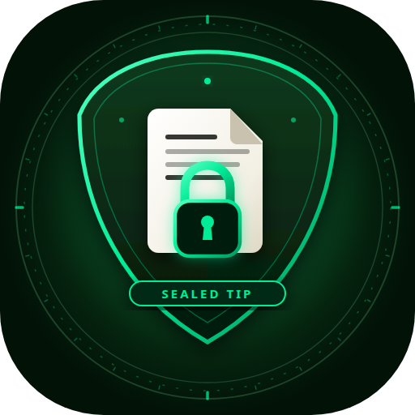
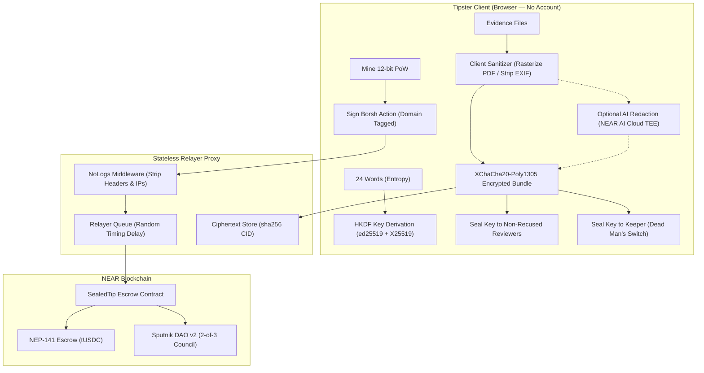

<div align="center">

  

  <h1>SEALED TIP</h1>

  <p>
    <strong>Anonymous Whistleblower Tip Line on NEAR Protocol</strong><br>
    <em>Rewards locked in advance · Evidence sanitized in-browser · Verifiable TEE AI · Multichain payouts · Dead man's switch</em>
  </p>

  <p>
    <a href="https://github.com/Teescom/sealed-tip/actions/workflows/ci.yml"></a>
    <a href="https://sealed-tip-ten.vercel.app"></a>
    <a href="https://near.org"></a>
    
    
    <a href="LICENSE"></a>
  </p>

  <p>
    <a href="https://sealed-tip-ten.vercel.app"><b>🌐 Live Application</b></a> •
    <a href="docs/p12/demo-video.mp4"><b>🎥 Demo Video (115s)</b></a> •
    <a href="ROADMAP.md"><b>🗺️ Roadmap</b></a> •
    <a href="ARCHITECTURE.md"><b>📐 Architecture</b></a> •
    <a href="docs/p12/hackathon-submission.md"><b>📜 Hackathon Form</b></a>
  </p>

</div>

---

## Objective

Whistleblowers take immense personal risks to report misconduct, but traditional channels force an impossible choice:
1. **Identify to get paid:** Official reward programmes require disclosing identity to operators who may retaliate or renege.
2. **Stay silent or unrewarded:** Anonymous systems (like SecureDrop) offer no financial compensation; public crypto tip lines expose whistleblowers to forensic and stylometric attacks.

**Sealed Tip solves this problem with a trustless, confidential protocol:**
- **Zero-Account Privacy:** Tipsters hold 24 recovery words (32 bytes entropy). All actions are signed with an ed25519 key derived in-browser via HKDF-SHA256 and verified on-chain. Tipsters never connect a wallet or reveal an address.
- **Client-Side Destructive Sanitization:** Evidence is cleaned in the browser before upload. PDFs are rasterized and rebuilt; images are re-encoded with EXIF/GPS stripped; printer tracking dots are suppressed.
- **Verifiable Private AI (NEAR AI Cloud TEE):** Optional redaction runs in an Intel TDX confidential enclave over OHTTP. The enclave issues hardware attestation quotes and ECDSA completion signatures verifiable offline.
- **Contract-Enforced Escrow:** Bounties are locked in a NEP-141 contract in advance. Tips require client-side 12-bit Proof-of-Work. Funds are reserved only upon credible triage by appointed reviewers, preventing funder rug-pulls.
- **Decentralized Governance:** Sputnik DAO v2 council (2-of-3 quorum) adjudicates final reward payouts. Tipsters can recuse compromised reviewers; recused members receive zero decryption keys.
- **Multichain Payouts:** Claim rewards to fresh anonymous NEAR implicit accounts with an automated gas drip, or bridge to Ethereum, Solana, or Tron via 1Click cross-chain intents.
- **Autonomous Dead Man's Switch:** If a whistleblower misses scheduled check-in deadlines, an autonomous keeper daemon releases the decryption keys to non-recused panel members.

---

## Live Deployments (NEAR Testnet)

| Component | Account / URL | Details |
|---|---|---|
| **Escrow & Tip Contract** | `sealedtip.st-deployer-f8d075.testnet` | 275 KB wasm deployed; manages tips, PoW, escrow, and switch |
| **Mock Token (tUSDC)** | `tusdc.st-deployer-f8d075.testnet` | NEP-141 token (6 decimals) |
| **Sputnik DAO v2 Panel** | `st-panel-f8d075.sputnik-v2.testnet` | 2-of-3 council quorum policy |
| **Web Application** | `https://sealed-tip-ten.vercel.app` | Production deployment on Vercel with dynamic per-request CSP nonces |
| **Relayer A & B** | `rel1.` / `rel2.st-deployer-f8d075.testnet` | Alternate transaction submissions on-chain |
| **Keeper Daemon** | `keeper.st-deployer-f8d075.testnet` | On-chain heartbeat & automated switch trigger execution |

---

## Architecture Flow



---

## How to Run & Verify

### Prerequisites & Toolchain
- **Rust:** Stable with `wasm32-unknown-unknown` target (`rustup target add wasm32-unknown-unknown`)
- **cargo-near:** `cargo install cargo-near`
- **Node.js:** ≥ 22 (tested on Node 24 & 26)
- **pnpm:** ≥ 9 (tested on pnpm 10 & 11)

### Quickstart

```bash
# 1. Clone repository
git clone https://github.com/Teescom/sealed-tip.git
cd sealed-tip

# 2. Install workspace dependencies
pnpm install

# 3. Build smart contracts
pnpm build:contract

# 4. Run full test suite (258 Rust + 418 TypeScript tests)
pnpm test

# 5. Run linters & typechecks
pnpm lint

# 6. Execute full PRD §8 acceptance test run (~1.3s)
pnpm demo

# 7. Run anti-spam stress test
pnpm spam
```

---

## Technical Limitations & Residual Risks

1. **24-Word Custody:** Anyone who possesses the 24 recovery words controls the tip and can claim the reward. Treat recovery phrases like secret keys.
2. **Network Anonymity:** Sealed Tip strips application headers and delays relay submissions, but does not provide network-layer routing anonymity. Whistleblowers should submit through Tor or a VPN.
3. **Printer Tracking Dots:** Software thresholding suppresses known printer dot patterns, but cannot guarantee 100% suppression against proprietary hardware micro-dot variants.
4. **Keeper Trust:** The dead man's switch relies on an appointed keeper to re-seal switch keys. In production, this daemon will run inside an audited confidential TEE enclave.
5. **Smart Contract Code:** While verified across 258 unit and integration tests, contracts are built for hackathon testnet demonstration and have not received an external third-party security audit.

---

## Disclosures & Compliance

- **Rust Dependencies:** `near-sdk` 5.30, `near-contract-standards` 5.30, `near-workspaces` 0.24, `near-sandbox` 2.14, `ed25519-dalek` 2.2.
- **TypeScript Dependencies:** `@noble/hashes` 2.4, `@noble/ed25519` 3.2, `@noble/curves` 2.2, `@scure/bip39` 2.4, `libsodium-wrappers` 0.8, `zod` 4.6, `next` 16.4.4, `react` 19.3, `tailwindcss` 4.3, `pdfjs-dist` 6.5, `pdf-lib` 1.17, `exifr` 7.1.
- **Vendored Code:** Sputnik DAO v2 wasm (`contracts/sealedtip/res/SPUTNIK_VERSION.txt`).
- **AI Tooling Disclosure:** Code, documentation, and tests were co-authored with AI coding agents following specifications in `AGENTS.md`, `ARCHITECTURE.md`, and `ROADMAP.md`. Maintainer owns architecture, code review, manual verification, testnet deployments, and secret management. Commits carry zero AI attribution trailers.
- **Single Entry:** Sealed Tip is our sole entry in the NEAR Hackathon 2026.

---

## License

[MIT](LICENSE)
